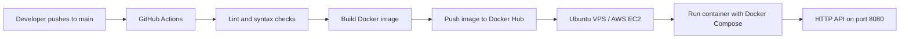

# DevOps Intern Screening Task

A minimal Flask API packaged with Docker, validated and published through GitHub Actions, plus a Linux system-health Bash script.

## Architecture



The workflow runs validation and a Docker build for pushes and pull requests targeting `main`. Publishing to Docker Hub happens only after a successful push to `main`.

## Repository structure

```text
.
├── app/
│   ├── app.py
│   ├── requirements.txt
│   └── requirements-dev.txt
├── .github/workflows/ci.yml
├── scripts/system_health.sh
├── Dockerfile
├── docker-compose.yml
├── .dockerignore
└── README.md
```

## API response

`GET /`

```json
{
  "message": "Hello from DevOps Intern Task!",
  "status": "running"
}
```

Health endpoint: `GET /health`

## Run locally with Docker Compose

Prerequisites: Docker Engine and the Docker Compose plugin.

```bash
git clone https://github.com/<your-github-username>/devops-intern-task.git
cd devops-intern-task
docker compose up --build -d
```

Test the application:

```bash
curl http://localhost:8080/
curl http://localhost:8080/health
```

View logs and stop the application:

```bash
docker compose logs -f
docker compose down
```

## GitHub Actions and Docker Hub setup

1. Create a public repository on Docker Hub named `devops-intern-task`.
2. In GitHub, open **Settings → Secrets and variables → Actions**.
3. Add these repository secrets:
   - `DOCKERHUB_USERNAME`: your Docker Hub username.
   - `DOCKERHUB_TOKEN`: a Docker Hub access token with read/write permission.
4. Push this project to the GitHub repository's `main` branch.

The workflow at `.github/workflows/ci.yml` runs Ruff linting, Python syntax validation, and a Docker build. On a successful push to `main`, it logs in to Docker Hub and publishes both `latest` and the commit-SHA image tags.

Never commit Docker Hub credentials or access tokens to the repository.

## Linux system health script

The script checks CPU utilization, memory utilization, and root filesystem disk utilization. It appends a timestamped report to `health_log.txt` and prints `[WARNING] Disk space high!` when disk usage is greater than 80%.

Run it on a Linux host:

```bash
chmod +x scripts/system_health.sh
./scripts/system_health.sh
```

Optionally choose a different log file:

```bash
./scripts/system_health.sh /var/log/system_health.log
```

The script reads CPU counters from `/proc/stat`, memory data from `free`, and disk usage from `df`. It samples CPU over a one-second interval.

## AWS EC2 / VPS deployment approach

1. **Build and push:** GitHub Actions builds the Docker image and pushes it to Docker Hub when code is pushed to `main`.
2. **Prepare the server:** Launch an Ubuntu EC2 instance, install Docker Engine and the Docker Compose plugin, and configure the security group to allow the required inbound application traffic.
3. **Deploy and maintain:** On the EC2 instance, pull the image and run it with Docker Compose. Use container health status and `docker compose logs` to inspect the service.

Example commands on the EC2 instance (replace the username with your Docker Hub username):

```bash
docker pull <dockerhub-username>/devops-intern-task:latest
docker run -d \
  --name devops-intern-task \
  --restart unless-stopped \
  -p 8080:8080 \
  <dockerhub-username>/devops-intern-task:latest
```

For a real production deployment, use HTTPS through a reverse proxy or load balancer, restrict inbound access, pin deployments to immutable image tags, and keep credentials in a secrets manager.

## Notes

- The assignment asks for a deployment approach; deploying to a live AWS account is not required for this repository deliverable.
- The Docker Hub publishing job requires the two GitHub Actions secrets described above.
- Do not expose port 8080 publicly without appropriate network controls and TLS termination.
