# DevOps Intern Screening Task

[](https://github.com/mdhabib99/git-test/actions/workflows/ci.yml)

A minimal Flask API packaged with Docker, validated by GitHub Actions, published to Docker Hub, and accompanied by a Linux system-health Bash script.

## Project links

- **GitHub source:** https://github.com/mdhabib99/git-test
- **Docker Hub image:** https://hub.docker.com/r/habib990/devops-intern-task
- **Published image:** `habib990/devops-intern-task:latest`

## Architecture

```mermaid
flowchart LR
    A[Developer pushes to main] --> B[GitHub Actions]
    B --> C[Lint and syntax checks]
    C --> D[Build Docker image]
    D --> E[Container smoke test]
    E --> F[Push image to Docker Hub]
    F --> G[Ubuntu VPS / AWS EC2]
    G --> H[Run container]
    H --> I[HTTP API on port 8080]
```



The workflow runs linting, Python syntax validation, a Docker image build, and a container smoke test for pushes and pull requests targeting `main`. On a successful push to `main`, it also publishes the image to Docker Hub using both `latest` and the Git commit SHA as tags.

## Repository structure

```text
.
├── app/
│   ├── app.py
│   ├── requirements.txt
│   └── requirements-dev.txt
├── .github/workflows/ci.yml
├── scripts/system_health.sh
├── Dockerfile
├── docker-compose.yml
├── .dockerignore
└── README.md
```

## API

### Main endpoint

`GET /`

Expected response:

```json
{
  "message": "Hello from DevOps Intern Task!",
  "status": "running"
}
```

### Health endpoint

`GET /health`

Expected response:

```json
{
  "status": "healthy"
}
```

## Run locally with Docker Compose

Prerequisites: Docker Engine and the Docker Compose plugin.

Clone this repository:

```bash
git clone https://github.com/mdhabib99/git-test.git
cd git-test
```

Build and start the application:

```bash
docker compose up --build -d
```

Verify the endpoints:

```bash
curl http://localhost:8080/
curl http://localhost:8080/health
```

View status and logs, then stop the application:

```bash
docker compose ps
docker compose logs -f
docker compose down
```

The application listens on container port `8080`, mapped to port `8080` on the host.

## Pull and run the published Docker Hub image

The image is available publicly on Docker Hub:

```bash
docker pull habib990/devops-intern-task:latest

docker run --detach \
  --name devops-intern-task \
  --restart unless-stopped \
  --publish 8080:8080 \
  habib990/devops-intern-task:latest
```

Then test it with:

```bash
curl http://localhost:8080/
```

To stop and remove the container:

```bash
docker rm --force devops-intern-task
```

## GitHub Actions and Docker Hub configuration

The workflow is stored at `.github/workflows/ci.yml`.

1. Create a Docker Hub repository named `devops-intern-task` and make it public.
2. In GitHub, open **Settings → Secrets and variables → Actions**.
3. Add these repository secrets:
   - `DOCKERHUB_USERNAME`: Docker Hub username.
   - `DOCKERHUB_TOKEN`: Docker Hub access token with permission to push images.
4. Push a commit to the `main` branch.

The workflow performs the following tasks:

- Installs Python dependencies and runs Ruff linting.
- Validates Python syntax.
- Builds the Docker image.
- Starts the image and checks that both `/health` and `/` return successful responses.
- On pushes to `main`, authenticates to Docker Hub and publishes `latest` and the commit-SHA image tags.

Credentials are stored as GitHub Actions secrets and must never be committed to the repository.

## Linux system health script

The standalone script `scripts/system_health.sh` checks:

- CPU utilization, sampled over a one-second interval using `/proc/stat`.
- Memory utilization using `free`.
- Root filesystem disk utilization using `df`.

It appends a timestamped report to `health_log.txt`. If disk usage is greater than 80%, it prints:

```text
[WARNING] Disk space high!
```

Run on a Linux host:

```bash
chmod +x scripts/system_health.sh
./scripts/system_health.sh
```

To select a different log file:

```bash
./scripts/system_health.sh /var/log/system_health.log
```

## AWS EC2 / VPS deployment approach

1. **Provision the server:** Launch an Ubuntu EC2 instance or VPS, apply security-group/firewall rules, and install Docker Engine and the Docker Compose plugin.
2. **Pull the image:** Authenticate to Docker Hub if needed, then pull `habib990/devops-intern-task:latest` (or preferably a specific commit-SHA tag for a reproducible release).
3. **Run and operate:** Start the container with Docker, configure HTTPS through a reverse proxy or load balancer, restrict inbound access, and review container health and logs.

**Deployment scope:** The application is built and verified locally with Docker. The Docker image is published to Docker Hub. A live AWS EC2/VPS deployment is not included in this task submission; the deployment approach above documents the proposed steps.

## Security and operational notes

- The Dockerfile runs the application as a non-root user and includes a container health check.
- The Compose service uses a read-only root filesystem, drops Linux capabilities, and enables `no-new-privileges`.
- Do not expose the application directly to the public internet without appropriate network controls and HTTPS termination.
